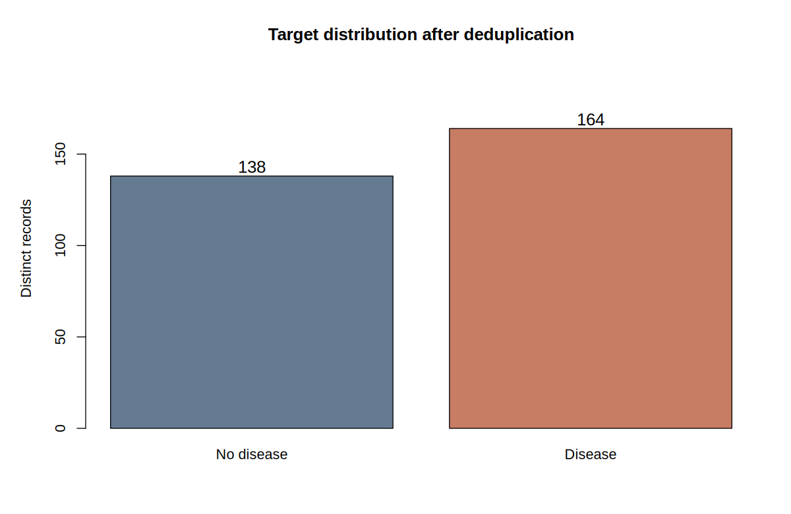
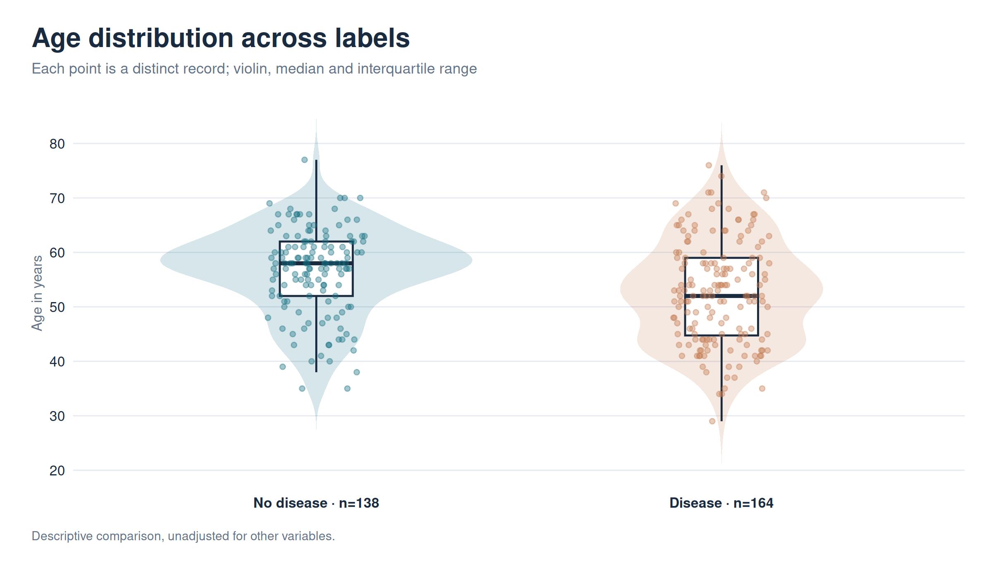
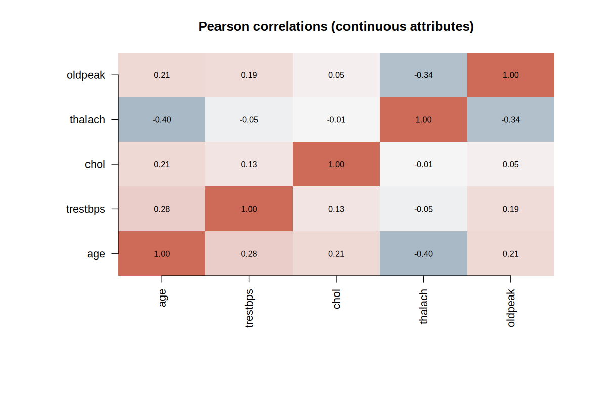
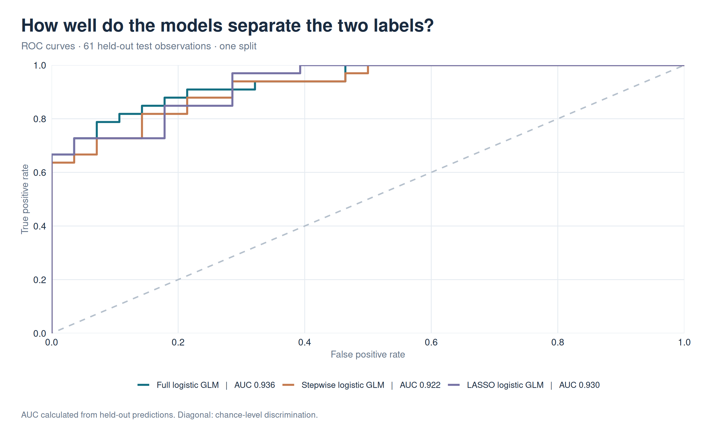
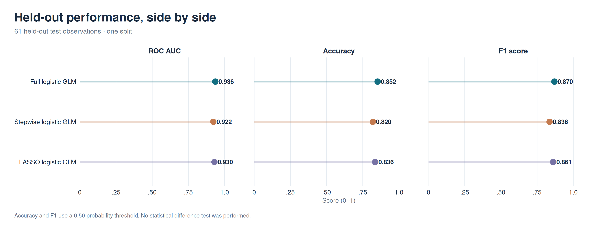
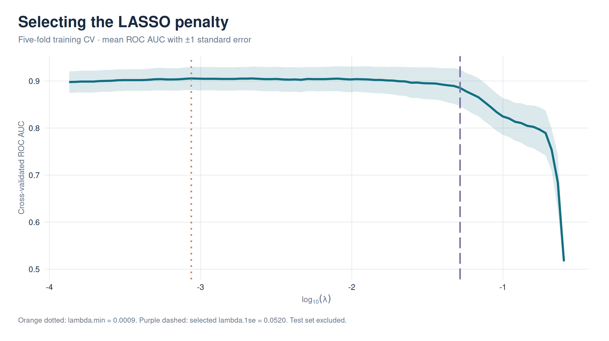
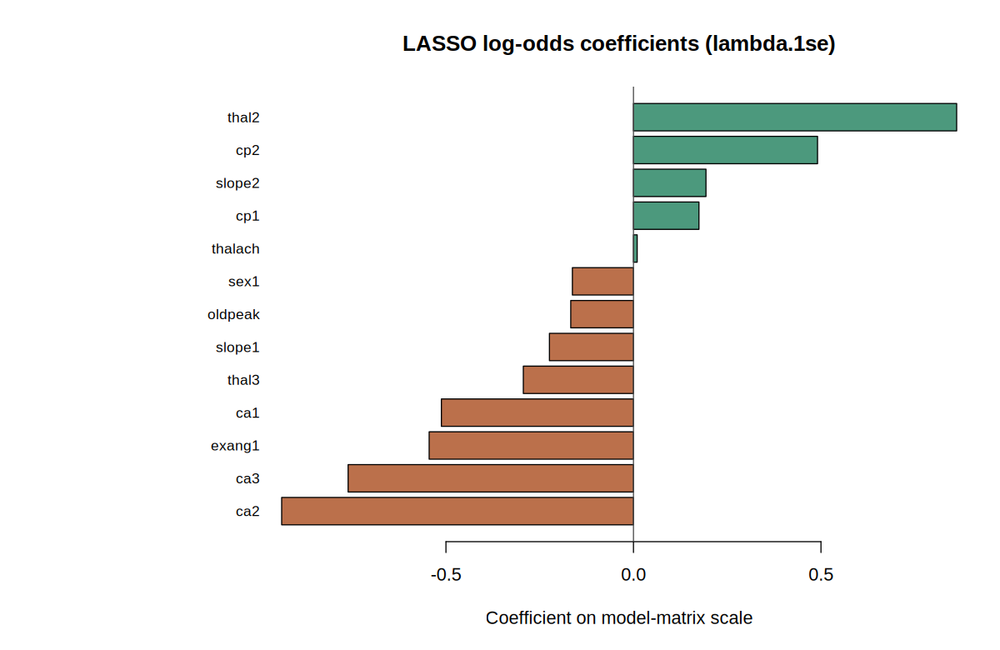

## Study objective

This report evaluates associations and prediction of the heart disease label
using generalized linear models. It is an **educational exercise**, not a
validated medical diagnostic system.

The original collaborative notebooks are preserved in
[the team source repository](https://github.com/davidhy8/heart-regression).
This report uses a cleaned, self-contained analysis pipeline.

## Data quality and evaluation design

`r knitr::kable(read.csv('results/data_audit.csv'), digits = 3)`

The raw heart dataset contains many exact duplicate rows. We removed
duplicates *before* stratified training/testing division and selected model
parameters *only* from training data. This prevents identical data rows from
being shared between the training and held-out test partitions.

## Outcome composition

```{r outcome, echo=FALSE, out.width='95%'}

```

## Exploratory clinical features

```{r age, echo=FALSE, out.width='95%'}

```

```{r corr, echo=FALSE, out.width='95%'}

```

## Models and held-out evaluation

We compared full logistic regression, stepwise logistic regression (AIC
selection on training data), and L1-penalized logistic regression (LASSO,
lambda selected by five-fold cross-validation within training data).
Categorical coded predictors were treated as factors and the test set was
never used to choose predictors or the regularization parameter.

```{r table, echo=FALSE, results='asis'}
knitr::kable(read.csv('results/model_metrics.csv'), digits=3)
```

```{r roc, echo=FALSE, out.width='95%'}

```

```{r compare, echo=FALSE, out.width='95%'}

```

## LASSO diagnostics and retained features

```{r cv, echo=FALSE, out.width='95%'}

```

```{r coefficients, echo=FALSE, out.width='95%'}

```

## Limitations

- The dataset is a small, duplicated, historical Cleveland-derived sample.
- The reported scores are from **one** deterministic held-out split rather than
  repeated external validation. They are not an estimate of prospective clinical
  performance with reliable uncertainty bounds.
- This is association and prediction, not causal inference.
- Disease-label definitions and source coding require caution.
- Do **not** use these models to make health or treatment decisions.

## Provenance

Original 2023 group project:
[David Yang, Arman Jahangiri, Mojtaba Kanani Sarcheshmeh](https://github.com/davidhy8/heart-regression).
Dataset:
[Kaggle Heart Disease Dataset](https://www.kaggle.com/datasets/johnsmith88/heart-disease-dataset).
