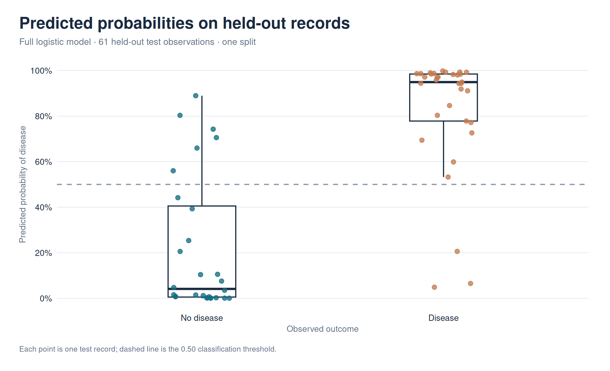

# Reproduced results

**Source dataset:** 1025 rows; **distinct records:** 302; **exact duplicates removed:** 723.
**Stratified split:** 241 training records, 61 held-out testing records (seed 2026).

All model selection and cross-validation occur on the training set. The test set is used
only for final evaluation. No clinical deployment or external validation is claimed.

| Model | Holdout ROC AUC | Accuracy | Precision | Recall | F1 | Brier |
|---|---:|---:|---:|---:|---:|---:|
| Full logistic GLM | 0.936 | 0.852 | 0.833 | 0.909 | 0.870 | 0.113 |
| Stepwise logistic GLM | 0.922 | 0.820 | 0.824 | 0.848 | 0.836 | 0.122 |
| LASSO logistic GLM | 0.930 | 0.836 | 0.795 | 0.939 | 0.861 | 0.119 |

## Interpretation and limitations

- AUC evaluates ranking; accuracy at a fixed 0.50 threshold can conceal calibration problems.
- Confidence intervals are not supplied: this is a small, single held-out split.
- The 1,025-row dataset has many exact repeats. Splitting those repeats across folds
  can overstate generalization; only distinct records are analysed here.
- The source is a repackaged Cleveland-derived dataset, not a current clinical cohort.
- Predictors are observational and do not support causal risk-factor claims.
- All models are educational; predictions must not be used for diagnosis.

## Figures

